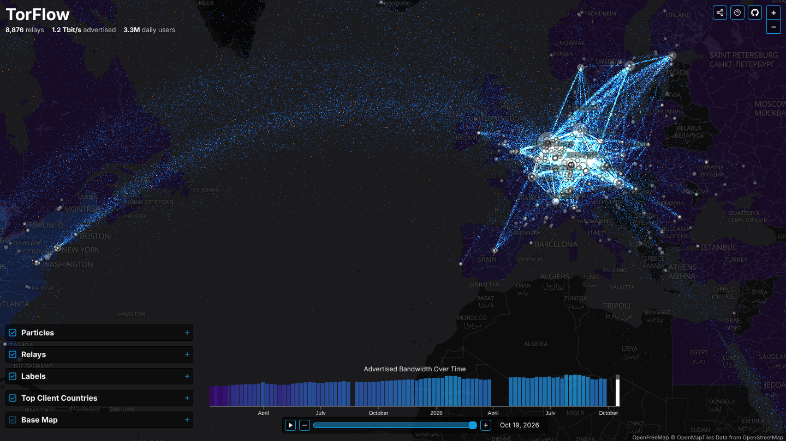

# TorFlow

> Data flow in the Tor network — relays, bandwidth and users around the world, updated daily.



TorFlow 2 keeps the original interface (a dark map with relays, animated
particle flows, a top-countries choropleth and a bandwidth timeline) and
replaces the Express + MySQL backend with a **GitHub Action** that builds the
whole thing, data included, as a static site on **GitHub Pages**. There is no
server, no database and no external account to set up.

```
CollecTor consensuses ─┐                        ┌─► data branch (days/*.json, append-only)
Tor Metrics CSVs ──────┼─► Action (daily) ──────┤
DB-IP city database ───┘                        └─► GitHub Pages: site + /data
```

## What's on the map

| Layer | Source | Notes |
| --- | --- | --- |
| Relays | Hourly network-status consensus from [CollecTor](https://collector.torproject.org), one per day | Relays are geolocated and grouped by location. A location's bandwidth is its share of consensus weight × the network's total advertised bandwidth. |
| Particles | Simulated circuits | Each particle is a guard→middle or middle→exit hop. Endpoints are sampled using the consensus position weights (`Wgg`, `Wmd`, `Wee`, …), the same way Tor clients choose relays. Orange particles show the onion-service share of traffic (v3 rendezvous cells ÷ consumed bandwidth, from Tor Metrics). This is a simulation: Tor doesn't reveal real flows. |
| Countries | [Tor Metrics](https://metrics.torproject.org) relay-user estimates | Top *N* countries by daily users. Clicking any country opens its daily history since 2011 and its busiest and quietest days. |
| Timeline | Tor Metrics `bandwidth.csv` | Advertised bandwidth over time. Only dates that have a relay snapshot can be selected. |
| Base map | [OpenFreeMap](https://openfreemap.org) dark style (OpenMapTiles, OSM) | Vector tiles, no API key. Labels are a separate layer drawn above the particles. |

Compared with the original:

- Data is current and refreshes automatically.
- Circuits follow real path-selection weights, and each relay shows its probability of being picked as guard, middle or exit.
- The onion-service share comes from data rather than a fixed 4%.
- The timeline has playback and arrow-key stepping.
- The share sheet offers copy link, the native share sheet, Bluesky, Mastodon, X, Reddit and email, plus "save map as image".
- URLs restore the view (`#date=…&map=…&country=…`).

## How the Action works

[`.github/workflows/pages.yml`](.github/workflows/pages.yml) runs on every push, daily at 03:17 UTC, and on demand:

1. **Restore snapshots.** It checks out the `data` branch into `out/`. That branch holds only `days/*.json`, one file per day, written once and never changed, so history stays small: about 110 KB per day uncompressed, and git compresses it further.
2. **Add new days.** `pipeline/update.js` fetches the latest consensuses (CollecTor's `/recent` keeps about 3 days), geolocates and aggregates them, and the new files are committed to `data`.
3. **Rebuild series.** `pipeline/publish.js` regenerates everything derived from Tor Metrics (`index.json`, `clients/*`) from scratch, so nothing that changes daily is ever committed.
4. **Deploy.** It builds the site with Vite, copies the data to `dist/data/`, and deploys to Pages.

### Setup

1. Go to **Settings → Pages → Build and deployment** and set **Source: GitHub Actions**.
2. Push to `main`, or run the workflow. The first run creates the `data` branch.
3. Optional: load history. Run the workflow manually with `mode=backfill`, `from=2025-01-01` and `every=7` (weekly). Each month's archive is about 25–55 MB and takes a few seconds to process.

Pages sites are limited to 1 GB. Daily snapshots come to about 40 MB a year, so for history older than a couple of years, use weekly or monthly (`every=7` / `every=30`) backfills.

**Notes**

- CollecTor's `/recent` covers only about 3 days, and a month's archive appears after the month ends. Gaps from a missed run can be filled with a backfill. A few historical archives have their own gaps (April 3–20, 2026, for example).
- Relay locations come from the current DB-IP database, so positions for older dates are approximate.

## Repository layout

```
pipeline/            Node scripts that build the data (only dependency: `maxmind`)
  update.js          latest consensuses -> days/*.json
  backfill.js        history from CollecTor's monthly archives -> days/*.json
  publish.js         Tor Metrics -> index.json, clients/*
  build-countries.js regenerates web/public/countries.geo.json from Natural Earth
  lib/               consensus parser, path weights, aggregation, metrics, output
  test/              node:test suite with format fixtures
web/                 the site (Vite, Leaflet, MapLibre, d3, WebGL)
.github/workflows/   pages.yml
```

### Data layout (served at `data/`)

| Path | Contents |
| --- | --- |
| `index.json` | dates that have snapshots + daily series: advertised/consumed bandwidth (Gbit/s), onion share, total users |
| `days/YYYY-MM-DD.json` | relay locations for one day, as columnar arrays sorted by weight |
| `clients/month/YYYY-MM.json` | users per country for each day of the month |
| `clients/country/CC.json` | one country's full daily user series |

## Local development

Requires Node 20+ and `tar` with `xz` support.

```bash
npm install
npm test                         # pipeline unit tests
npm run data:update              # ./out/days (downloads the DB-IP database on first run, ~130 MB)
npm run data:backfill -- --from 2026-01-01 --every 7   # optional history
npm run data:publish             # ./out/index.json + clients/
npm run dev                      # http://localhost:5173, serves ./out at /data
```

- `GEOIP_DB=/path/to/db.mmdb` uses another MMDB city database, for example MaxMind GeoLite2-City.
- `OUT_DIR` / `CACHE_DIR` move the output and download cache.
- Behind an HTTP proxy, set `NODE_USE_ENV_PROXY=1`.
- `VITE_DATA_URL` makes the site read data from another host.

## Credits

TorFlow was created by [Uncharted Software](https://uncharted.software)
(Chris Dickson, Kevin Birk). Licensed under the Apache License 2.0.

Tor data © The Tor Project (CC BY 3.0 US). [IP Geolocation by DB-IP](https://db-ip.com)
(CC BY 4.0). Map © [OpenFreeMap](https://openfreemap.org),
© [OpenMapTiles](https://www.openmaptiles.org/), data from
[OpenStreetMap](https://www.openstreetmap.org/copyright).
